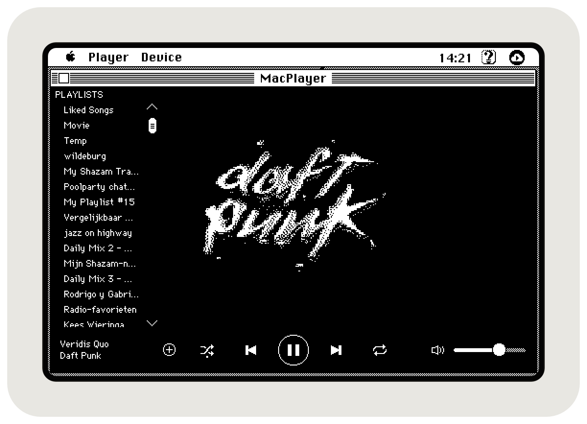

# MacPlayer

**A Spotify Connect remote for 68k Macs, working again and doing its own HTTPS.**

MacPlayer is [Anthony Super](https://github.com/antscode)'s app from 2018: a classic Mac that shows what Spotify is playing and controls it. [Hackaday wrote about it](https://hackaday.com/2018/12/21/giving-an-old-mac-spotify/), I thought it was super cool, and it's the reason [Notion Classic](https://github.com/SLKK-design/NotionClassic) exists.



Back then an SE/30 couldn't do the encryption itself. Anthony's own README for his mbedTLS port put a handshake on a 16 MHz 68030 at about 70 seconds, long after the server gives up. So MacPlayer sent plain HTTP to an OpenWRT router running stunnel, and the router did the HTTPS. Logging in and converting album covers went through his web service at 68k.io.

68k.io has since gone offline, and the domain isn't registered any more. So the 2018 version can't log in or show a cover today, even with the router set up.

This version brings it back by doing all of that on the Mac. It uses the HTTPS engine from [Claude 68](https://github.com/SLKK-design/Claude68), the same one Notion Classic runs on, so the Mac speaks TLS 1.2 to Spotify directly. There's no OpenWRT box running stunnel and no 68k.io in between any more. The Mac only needs a network connection.

## What it does

MacPlayer is a remote. The music plays on another Spotify device, such as your phone, a computer or a speaker, and you pick it from the Device menu.

- Your Liked Songs and playlists
- The round + next to the track name adds it to Liked Songs, as in Spotify
- Play, pause, next, previous and volume
- The album cover, dithered for a black-and-white screen
- Full screen (Player > Full Screen, ⌘F), for a Mac that's only there to show what's playing

Spotify only allows playback control for Premium accounts.

> [!WARNING]
> The connection is encrypted, but the Mac isn't: any app on it can read the prefs file with your Spotify login. You can remove MacPlayer's access in your Spotify account at any time.

## What changed since 2018

| | 2018 | Now |
|---|---|---|
| HTTPS | stunnel on an OpenWRT router, reached through MacWifi | On the Mac, with the Claude 68 engine |
| Network | An Ethernet card plus an OpenWRT wifi box for MacWifi | Any MacTCP or Open Transport network, including the SCSI network adapter that BlueSCSI and PiSCSI emulate |
| Login | Through 68k.io, now gone | A one-time script on a modern computer |
| Album covers | Converted to PICT by 68k.io, now gone | JPEG straight from Spotify, decoded and dithered on the Mac |

## How the Mac does HTTPS

The engine runs mbedTLS 3.2.1, the same build as Claude 68, with the slow parts swapped for code tuned to the 68030: an X25519 key exchange on custom 68020 assembly, with the key pair made before it's needed. Spotify's servers use RSA certificates, not the ECDSA ones Notion's Cloudflare uses, so mbedTLS checks those signatures with its own RSA code.

After the first connection, MacPlayer keeps session tickets for `api.spotify.com` and Spotify's image server on disk. The next connection resumes the saved session and skips the key exchange.

## Requirements

```text
A Macintosh with at least:

CPU            68020
App partition  2.4 MB
System RAM     8 MB
OS             System 7.5
Network        Ethernet card, DaynaPORT, PiSCSI or BlueSCSI
Spotify        A Premium account, and a free Spotify developer app
               (step 1 below)
Once           A modern computer with Python 3, to log in
```

## Download

<a href="https://github.com/SLKK-design/MacPlayer/releases/latest/download/MacPlayer.sit"></a>Get [MacPlayer.sit](https://github.com/SLKK-design/MacPlayer/releases/latest/download/MacPlayer.sit) (StuffIt, for the Mac itself) or [MacPlayer.zip](https://github.com/SLKK-design/MacPlayer/releases/latest/download/MacPlayer.zip).

## Logging in

The Mac never opens the Spotify login page. A one-time script on a modern computer logs in (the same approach as [spotify-matrix](https://github.com/tnarla/spotify-matrix)) and writes MacPlayer's preferences file for you.

1. In the [Spotify developer dashboard](https://developer.spotify.com/dashboard), click Create app, choose Web API, and add this Redirect URI exactly: `http://127.0.0.1:8888/callback`. The app's Settings page shows the Client ID and, under View client secret, the Client Secret. The script prints these steps too.
2. On a modern computer, run `python3 tools/spotify_auth.py` (no extra packages needed). Enter your Client ID and Client Secret, and log in in the browser that opens. The script writes a `MacPlayer Preferences` file in the current folder (`--out` picks another path).
3. Copy that file into System Folder:Preferences on the Mac, replacing any old one. With Basilisk II, a shared folder makes this a drag and drop.
4. Open MacPlayer. It logs in by itself and keeps itself logged in from then on.

Do this again only if MacPlayer can't log in any more, for example after you reset the Client Secret or remove MacPlayer's access in your Spotify account. A login from before Liked Songs was added also needs redoing to use Liked Songs. If MacPlayer is open, quit and reopen it after copying the new file.

## Files on the Mac

MacPlayer keeps three things in System Folder:Preferences:

- **MacPlayer Preferences:** your Client ID, Client Secret and refresh token, plus the full-screen setting. Keep it private.
- **MacPlayer TLS Cache:** the DNS answer, session tickets, other handshake shortcuts and a random seed for the next launch. Safe to delete; it rebuilds itself.
- **MacPlayer Cache:** album covers it has already shown.

## Building

You only need [Retro68](https://github.com/autc04/Retro68). The 68k mbedTLS and MacTCPHelper libraries come pre-built in `src/core/lib`.

```bash
cmake -S . -B build -DCMAKE_TOOLCHAIN_FILE=<Retro68-build>/toolchain/m68k-apple-macos/cmake/retro68.toolchain.cmake
make -C build
```

This produces `build/MacPlayer.APPL`, `MacPlayer.bin` and `MacPlayer.dsk`. Copy the app to the Mac with its resource fork intact (the `.bin` or the `.dsk` image do that).

**Debug log.** Build with `-DMACPLAYER_LOG=ON` and MacPlayer writes `MacPlayer Log` next to the app: every network step with its time in ticks, free memory and stack, new at every launch. It's off by default.

```
src/
  MacPlayer.cpp   event loop and player UI
  api/            Spotify Web API client
  ui/CDEF/        custom list, scroll bar and slider definitions
  core/           Claude 68 engine: HTTP/TLS, grow-zone, caches, libs
tools/
  spotify_auth.py one-time login, writes the MacPlayer Preferences file
```

`src/core` is a copy of Claude 68's engine. `net/HttpClient`, `net/Uri`, `net/RootCert` and `helpers/tls_cache.h` are adapted for Spotify (several hosts, form POSTs, Spotify's certificates, a second saved session), with the changes marked `MacPlayer:`. The rest is unchanged.

## Sibling projects

<a href="https://github.com/SLKK-design/NotionClassic"></a>&nbsp; **[Notion Classic](https://github.com/SLKK-design/NotionClassic)**: reads and edits Notion pages.<br>
<a href="https://github.com/SLKK-design/Claude68"></a>&nbsp; **[Claude 68](https://github.com/SLKK-design/Claude68)**: a Claude chat client, and the starting point for your own 68k HTTPS app.<br>
<a href="https://github.com/SLKK-design/HTTPS-68K-Speedtest"></a>&nbsp; **[Speed Test](https://github.com/SLKK-design/HTTPS-68K-Speedtest)**: times every handshake method on your Mac.

## Credits

**MacPlayer is Anthony Super's (antscode).** He wrote the app and its interface in 2018, and he also wrote [MacHTTP](https://github.com/antscode/MacHTTP), [mbedtls-Mac-68k](https://github.com/antscode/mbedtls-Mac-68k) and [MacTCPHelper](https://github.com/antscode/MacTCPHelper), the libraries the HTTPS engine grew out of. The original is at [github.com/antscode/MacPlayer](https://github.com/antscode/MacPlayer). Thank you, Anthony.

The 2026 changes are by Lin van der Slikke, built with [Claude Code](https://claude.ai/code).

From the original MacPlayer:

- Built using [Retro68](https://github.com/autc04/Retro68) by Wolfgang Thaller
- Custom scroll bars based on a code snippet by Alexander S. Colwell, 1988
- Custom slider based on code samples by Jim Stout, 1995
- The cursive font in the logo is [Streamster](https://befonts.com/streamster-font.html) by Youssef Habchi

Bundled libraries, each under its own license:

- [mbedTLS](https://github.com/Mbed-TLS/mbedtls) (ARM/Mbed, Apache 2.0)
- [micro-ecc](https://github.com/kmackay/micro-ecc) (Kenneth MacKay, BSD 2-clause)
- [curve25519-donna](https://github.com/agl/curve25519-donna) (Adam Langley / Google, BSD 3-clause), where the X25519 code started
- [stb_image](https://github.com/nothings/stb) (Sean Barrett, public domain or MIT), for the album covers
- [http-parser](https://github.com/nodejs/http-parser) (Joyent / Node.js contributors, MIT), [yuarel](https://github.com/jackenl/yuarel) (Jack Engqvist Johansson, MIT), [gason](https://github.com/vivkin/gason) (Ivan Vashchaev, MIT)
- [spotify-matrix](https://github.com/tnarla/spotify-matrix) by tnarla, for the login approach

MacPlayer is not made by or affiliated with Spotify.
